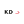
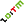
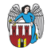

<p align="center">
  
  
  <a href="https://www.home-assistant.io/"></a>
  
  <a href="https://github.com/superdarco78"></a>
</p>

<h1 align="center">🚆 Ikony przewoźników</h1>

<p align="center">Ikony polskich przewoźników transportu publicznego: kolej, tramwaje i autobusy miejskie.<br>
Gotowe do kart Home Assistanta (odjazdy, rozkłady, powiadomienia).<br>
<sub>🇬🇧 Icons of Polish public transport operators, ready for Home Assistant cards.</sub></p>

## 🖼 Wszystkie ikony

<table>
<tr><td align="center" width="120"><br><sub>ZTM Warszawa</sub><br><sub><code>ztm_warszawa</code></sub></td><td align="center" width="120"><br><sub>PolRegio</sub><br><sub><code>polregio</code></sub></td><td align="center" width="120"><br><sub>PKP Intercity</sub><br><sub><code>pkp_intercity</code></sub></td><td align="center" width="120"><br><sub>Koleje Mazowieckie</sub><br><sub><code>koleje_mazowieckie</code></sub></td><td align="center" width="120"><br><sub>WKD</sub><br><sub><code>wkd</code></sub></td><td align="center" width="120"><br><sub>PKP SKM Trojmiasto</sub><br><sub><code>pkp_skm_trojmiasto</code></sub></td></tr>
<tr><td align="center" width="120"><br><sub>Koleje Slaskie</sub><br><sub><code>koleje_slaskie</code></sub></td><td align="center" width="120"><br><sub>Koleje Dolnoslaskie</sub><br><sub><code>koleje_dolnoslaskie</code></sub></td><td align="center" width="120"><br><sub>Koleje Wielkopolskie</sub><br><sub><code>koleje_wielkopolskie</code></sub></td><td align="center" width="120"><br><sub>SKM Warszawa</sub><br><sub><code>skm_warszawa</code></sub></td><td align="center" width="120"><br><sub>LKA</sub><br><sub><code>lka</code></sub></td><td align="center" width="120"><br><sub>Koleje Malopolskie</sub><br><sub><code>koleje_malopolskie</code></sub></td></tr>
<tr><td align="center" width="120"><br><sub>Arriva RP</sub><br><sub><code>arriva</code></sub></td><td align="center" width="120"><br><sub>RegioJet</sub><br><sub><code>regiojet</code></sub></td><td align="center" width="120"><br><sub>Leo Express</sub><br><sub><code>leo_express</code></sub></td><td align="center" width="120"><br><sub>ZTM GZM</sub><br><sub><code>ztm_gzm</code></sub></td><td align="center" width="120"><br><sub>ZDMiKP Bydgoszcz</sub><br><sub><code>zdmikp_bydgoszcz</code></sub></td><td align="center" width="120"><br><sub>MZDiK Radom</sub><br><sub><code>mzdik_radom</code></sub></td></tr>
<tr><td align="center" width="120"><br><sub>ZTM Rzeszow</sub><br><sub><code>ztm_rzeszow</code></sub></td><td align="center" width="120"><br><sub>ZTM Lublin</sub><br><sub><code>ztm_lublin</code></sub></td><td align="center" width="120"><br><sub>ZTM Kielce</sub><br><sub><code>ztm_kielce</code></sub></td><td align="center" width="120"><br><sub>MZK Torun</sub><br><sub><code>mzk_torun</code></sub></td><td align="center" width="120"><br><sub>MZK Wejherowo</sub><br><sub><code>mzk_wejherowo</code></sub></td><td align="center" width="120"><br><sub>MPK Lomza</sub><br><sub><code>mpk_lomza</code></sub></td></tr>
<tr><td align="center" width="120"><br><sub>KA Swinoujscie</sub><br><sub><code>ka_swinoujscie</code></sub></td><td align="center" width="120"><br><sub>GZK Bystry</sub><br><sub><code>gzk_bystry</code></sub></td><td align="center" width="120"><br><sub>MZK Elk</sub><br><sub><code>mzk_elk</code></sub></td><td align="center" width="120"><br><sub>ZKM Elblag</sub><br><sub><code>zkm_elblag</code></sub></td><td align="center" width="120"><br><sub>MZK Gorzow Wlkp</sub><br><sub><code>mzk_gorzow</code></sub></td><td align="center" width="120"><br><sub>ZTP Krakow</sub><br><sub><code>ztp_krakow</code></sub></td></tr>
<tr><td align="center" width="120"><br><sub>UM Wroclaw</sub><br><sub><code>um_wroclaw</code></sub></td><td align="center" width="120"><br><sub>ZTM Poznan</sub><br><sub><code>ztm_poznan</code></sub></td><td align="center" width="120"><br><sub>ZTM Gdansk</sub><br><sub><code>ztm_gdansk</code></sub></td><td align="center" width="120"><br><sub>ZDiTM Szczecin</sub><br><sub><code>zditm_szczecin</code></sub></td><td align="center" width="120"><br><sub>BKM Bialystok</sub><br><sub><code>bkm_bialystok</code></sub></td><td align="center" width="120"><br><sub>ZKM Gdynia</sub><br><sub><code>zkm_gdynia</code></sub></td></tr>
<tr><td align="center" width="120"><br><sub>MPK Czestochowa</sub><br><sub><code>mpk_czestochowa</code></sub></td><td align="center" width="120"><br><sub>ZDZiT Olsztyn</sub><br><sub><code>zdzit_olsztyn</code></sub></td></tr>
</table>

## 🏠 Jak użyć w Home Assistancie

Wklej adres ikony tam, gdzie karta przyjmuje obrazek, np. w karcie **Obraz** albo jako `entity_picture`:

```
https://raw.githubusercontent.com/superdarco78/ikony-przewoznikow/main/ikony/<nazwa>.webp
```

Przykład (PKP Intercity):

```yaml
type: picture
image: https://raw.githubusercontent.com/superdarco78/ikony-przewoznikow/main/ikony/pkp_intercity.webp
```

## 🔄 Aktualizacja ikon

Skrypt `pobierz_ikony.py` pobiera ikony ze stron przewoźników, zamienia je na WebP i zapisuje raport w `ikony/_raport.txt`.

```
python pobierz_ikony.py
```

## ⚖️ Prawa

Logotypy i ikony należą do ich właścicieli (przewoźników). Repozytorium zbiera je tylko do rozpoznawania przewoźnika w domowym Home Assistancie. Skrypt: © superdarco78.
